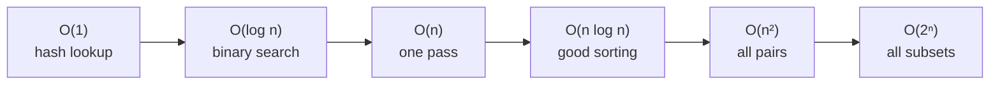

+++
id = "dsa.foundations.big-o"
title = "Big-O: how cost grows"
strand = "algorithms"
module = "foundations"
role_tags = ["ai-engineer", "backend"]
hard_prereqs = []
soft_prereqs = []
bridges = ["dsa.patterns.two-pointers", "sys.db.indexes", "ai.dl.attention"]
interview_weight = 5
key_points = [
  "Big-O describes how time or memory grows with input size n, ignoring constant factors and smaller terms.",
  "Common classes from fast to slow: O(1), O(log n), O(n), O(n log n), O(n²), O(2ⁿ).",
  "Sequential steps add; nested loops multiply; repeatedly halving the problem gives log n.",
  "Always state time and space, and which case you mean — worst, average or amortised (e.g., appending to a dynamic array is amortised O(1)).",
]
est_minutes = { core = 5, extended = 4, deep = 15 }

[[references]]
title = "Big-O Cheat Sheet"
url = "https://www.bigocheatsheet.com/"
kind = "tool"
note = "Quick lookup for common data structures and sorts."

[[references]]
title = "MIT 6.006 Introduction to Algorithms (Spring 2020)"
url = "https://ocw.mit.edu/courses/6-006-introduction-to-algorithms-spring-2020/"
kind = "course"
note = "Free lectures; lecture 1 covers asymptotic analysis."

[[references]]
title = "NeetCode Roadmap"
url = "https://neetcode.io/roadmap"
kind = "course"
note = "Pattern-by-pattern practice list used throughout the DSA strand."

[guess]
type = "single_choice"
prompt = "For very large n, which grows faster: 1000 · n or n²?"
options = ["1000 · n", "n²", "They grow at the same rate"]
answer = 1
explanation = "n² wins once n passes 1000, and the gap explodes after that. That's why Big-O ignores constant factors: for big inputs, the shape of the growth matters more than the constant in front."

[[questions]]
id = "binary-search"
type = "complexity_pick"
prompt = "What is the time complexity of binary search on a sorted array of n items?"
options = ["O(1)", "O(log n)", "O(n)", "O(n log n)"]
answer = 1
explanation = "Each comparison halves the remaining range, so after k steps n/2ᵏ items remain. That reaches 1 when k = log₂ n."
difficulty = 1

[[questions]]
id = "triangle-loop"
type = "complexity_pick"
prompt = '''
What's the time complexity?

```python
for i in range(n):
    for j in range(i, n):
        do_constant_work()
```
'''
options = ["O(n)", "O(n log n)", "O(n²)", "O(2ⁿ)"]
answer = 2
explanation = "The inner loop runs n, n−1, …, 1 times: n(n+1)/2 steps in total. Drop the constant ½ and the smaller term and you get O(n²)."
difficulty = 1

[[questions]]
id = "sequential-loops"
type = "complexity_pick"
prompt = '''
`a` has n items and `b` has m items. What's the time complexity?

```python
for x in a:
    process(x)
for y in b:
    process(y)
```
'''
options = ["O(n · m)", "O(n + m)", "O(max(n, m)²)", "O(1)"]
answer = 1
explanation = "Loops that run one after the other add. Nested loops would multiply to O(n · m)."
difficulty = 1

[[questions]]
id = "halving"
type = "complexity_pick"
prompt = '''
What's the time complexity?

```python
i = n
while i > 1:
    i //= 2
```
'''
options = ["O(1)", "O(log n)", "O(√n)", "O(n)"]
answer = 1
explanation = "i halves every iteration, so the loop runs about log₂ n times."
difficulty = 1

[[questions]]
id = "amortised-append"
type = "single_choice"
prompt = "Appending to a Python list (a dynamic array) is O(1) amortised. Why amortised?"
options = [
  "Appends never copy anything",
  "Occasionally the array is full and gets copied to a larger one, but capacity grows geometrically, so the copying averages out to O(1) per append",
  "Python stores lists as linked lists",
  "The interpreter caches the last element",
]
answer = 1
explanation = "Most appends are O(1). When capacity runs out the list moves to a bigger block, an O(n) copy — but because capacity grows by a constant factor, those copies are rare enough that the total cost of n appends is O(n), i.e. O(1) each on average."
difficulty = 2

[[questions]]
id = "hash-worst-case"
type = "single_choice"
prompt = "A hash table uses chaining. Every key happens to hash to the same bucket. What's the cost of one lookup?"
options = ["O(1)", "O(log n)", "O(n)", "O(n²)"]
answer = 2
explanation = "All n keys sit in one chain, so a lookup scans it: O(n). Hash tables are O(1) on average with a good hash function, not in the worst case."
difficulty = 2

[[questions]]
id = "hidden-quadratic"
type = "spot_the_bug"
prompt = "This runs fine on small inputs but times out at n = 100,000. Which line makes it O(n²)?"
language = "python"
code = '''
def has_duplicate(nums):
    seen = []
    for x in nums:
        if x in seen:
            return True
        seen.append(x)
    return False
'''
options = [
  "Line 3: the for loop",
  "Line 4: `x in seen` scans a list",
  "Line 6: `seen.append(x)`",
  "Line 7: `return False`",
]
answer = 1
explanation = "`x in seen` on a list is a linear scan, and it runs once per element: O(n²) overall. Make `seen` a set and membership checks become O(1) on average, so the whole function is O(n)."
difficulty = 2

[[questions]]
id = "will-it-pass"
type = "scenario_tradeoff"
scenario = "An interview problem allows n up to 100,000 and a time limit of about one second. Your first idea is a double loop over all pairs."
prompt = "What should you do?"
options = [
  "Code it — 100,000 is small",
  "Look for O(n log n) or O(n): n² is about 10¹⁰ steps, far too many",
  "Code it in a faster language and it'll be fine",
]
answer = 1
explanation = "Rough rule: aim for about 10⁷–10⁸ simple operations per second. n² = 10¹⁰ is 100+ times over budget in any language. Mention the brute force, then find a better approach (sorting, hashing, two pointers…)."
difficulty = 2

[[questions]]
id = "sort-lower-bound"
type = "single_choice"
prompt = "What's the best possible worst-case time for sorting n items using only comparisons?"
options = ["O(n)", "O(n log n)", "O(n²)", "O(log n)"]
answer = 1
explanation = "Any comparison sort needs Ω(n log n) comparisons in the worst case. Beating it needs extra assumptions about the data, e.g. counting sort for small integer ranges."
difficulty = 3

[[questions]]
id = "recursion-space"
type = "complexity_pick"
prompt = "A recursive depth-first search visits every node of a tree of height h. How much extra space does the call stack need?"
options = ["O(1)", "O(log n)", "O(h)", "O(n²)"]
answer = 2
explanation = "At most h calls are on the stack at once, one per level of the current path. That's O(log n) for a balanced tree but O(n) for a tree shaped like a linked list."
difficulty = 2
+++

## Hook {core}

Two solutions both pass the sample tests. At n = 1,000,000, one does about 20 million steps (n log n) and finishes in milliseconds; the other does 10¹² steps (n²) and runs for minutes or hours, depending on the language.

Big-O is how you see that difference **before** running anything, and it's the first thing an interviewer expects you to say about any solution.

## The idea {core}

Big-O describes **how cost grows as the input grows**. It keeps the shape of the growth and drops what stops mattering for large n:

- **Constants:** 3n and n are both **O(n)**.
- **Smaller terms:** n² + n + 7 is **O(n²)**.

From fastest to slowest growth:



| n = 1,000,000 | Steps (roughly) |
|---|---|
| O(log n) | 20 |
| O(n) | 1,000,000 |
| O(n log n) | 20,000,000 |
| O(n²) | 1,000,000,000,000 |

## Counting rules {core}

1. **Sequential steps add:** a loop over n, then a loop over m → O(n + m).
2. **Nested loops multiply:** a loop over n inside a loop over n → O(n²).
3. **Halving gives log n:** anything that cuts the problem in half each step (binary search, balanced trees) → O(log n).
4. **Divide and recombine:** split in half and do linear work to combine (merge sort) → O(n log n).

Count **space** the same way: extra arrays, hash sets, and the recursion stack all count.

## Connects to {core}

- **Two pointers** — the next topic turns an O(n²) pair search into O(n).
- **Database indexes** — a B-tree index turns an O(n) table scan into an O(log n) lookup.
- **Transformers** — self-attention compares every token with every other token: O(n²) in sequence length, which is why long context is expensive.

## Amortised and average cases {extended}

- **Amortised:** appending to a dynamic array is O(1) *on average over many appends*, even though an occasional resize copies everything.
- **Average vs worst:** a hash table is O(1) on average but O(n) when every key collides.
- **Say which one you mean.** "O(1) amortised" and "O(1) worst case" are different promises.

## Interview angle {extended}

- State the brute force and its complexity first, then improve. Interviewers reward the reasoning, not just the final answer.
- Always give **time and space**: "O(n) time, O(n) extra space for the hash set."
- Budget check: about 10⁷–10⁸ simple steps per second. With n = 10⁵, O(n²) is too slow; O(n log n) is fine.
- Classic follow-up: "Can you beat O(n log n) for sorting?" — not with comparisons alone.

## Go deeper {deep}

- Watch MIT 6.006 lecture 1 (in the references).
- **Try it:** time sorting 10⁴, 10⁵ and 10⁶ random numbers, then time the list-based `has_duplicate` from the quiz on the same sizes. Plot both; the curves are the lesson.
- Start the NeetCode roadmap's "Arrays & Hashing" section — every problem there is a Big-O exercise in disguise.
