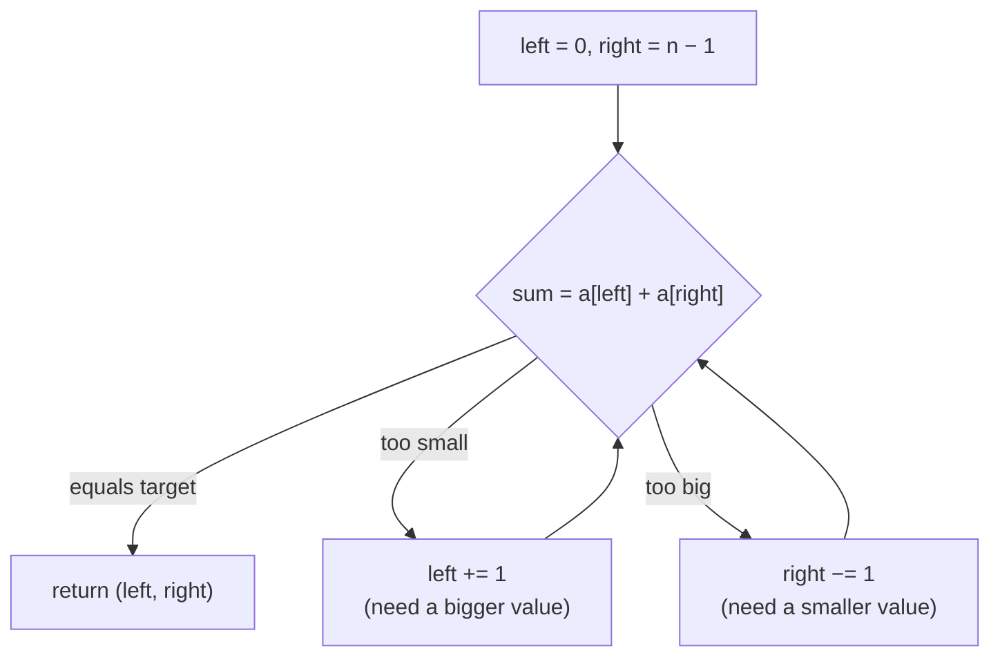

+++
id = "dsa.patterns.two-pointers"
title = "Two pointers"
strand = "algorithms"
module = "patterns"
role_tags = ["ai-engineer", "backend"]
hard_prereqs = []
soft_prereqs = ["dsa.foundations.big-o"]
bridges = ["dsa.patterns.sliding-window", "dsa.search.binary-search", "dsa.sorting.merge-sort"]
interview_weight = 5
key_points = [
  "Two indexes move through the data so each step rules out many candidates at once, often turning O(n²) into O(n).",
  "It works when the data is sorted or the condition is monotonic, so moving a pointer is provably safe.",
  "Three common shapes: opposite ends moving inward, fast/slow pointers moving the same way, and one pointer per input when merging.",
  "Signals: sorted array, find a pair or triplet, do it in place, palindrome, O(1) extra space.",
]
est_minutes = { core = 6, extended = 4, deep = 30 }

[[references]]
title = "NeetCode Roadmap — Two Pointers"
url = "https://neetcode.io/roadmap"
kind = "course"
note = "Open the Two Pointers node for the practice list with video solutions."

[[references]]
title = "LeetCode 167 — Two Sum II (Input Array Is Sorted)"
url = "https://leetcode.com/problems/two-sum-ii-input-array-is-sorted/"
kind = "tool"
note = "The canonical opposite-ends problem."

[[references]]
title = "LeetCode 11 — Container With Most Water"
url = "https://leetcode.com/problems/container-with-most-water/"
kind = "tool"
note = "Two pointers where the 'which side to move' argument is the whole interview."

[guess]
type = "single_choice"
prompt = "A sorted array, and you need two numbers that add up to a target. Without extra memory, what's the best time you can get?"
options = ["O(n²)", "O(n log n)", "O(n)"]
answer = 2
explanation = "O(n): start one pointer at each end and move one of them inward each step. Sortedness tells you which one to move."

[[questions]]
id = "pair-sum-complexity"
type = "complexity_pick"
prompt = "Two pointers from both ends of a sorted array to find a pair with a given sum. Time complexity?"
options = ["O(log n)", "O(n)", "O(n log n)", "O(n²)"]
answer = 1
explanation = "Every step moves one pointer one place inward, and they stop when they meet: at most n − 1 steps. O(1) extra space."
difficulty = 1

[[questions]]
id = "which-way"
type = "single_choice"
prompt = "Sorted array, pointers at both ends. The current sum is smaller than the target. What do you do?"
options = [
  "Move the left pointer right",
  "Move the right pointer left",
  "Move both pointers inward",
  "Restart from the middle",
]
answer = 0
explanation = "You need a bigger sum. Moving left rightward picks a larger (or equal) value. Moving right leftward could only make the sum smaller."
difficulty = 1

[[questions]]
id = "unsorted-tight-memory"
type = "scenario_tradeoff"
scenario = "The array is NOT sorted, you need any pair that sums to a target, and extra memory is very tight. You're allowed to reorder the array."
prompt = "Which approach fits best?"
options = [
  "Hash set of seen values: O(n) time, O(n) extra space",
  "Sort in place, then two pointers: O(n log n) time, O(1) extra space",
  "Check all pairs: O(n²) time, O(1) space",
]
answer = 1
explanation = "With tight memory, sort in place then use two pointers. The hash-set approach is faster but costs O(n) memory. Saying this trade-off out loud is exactly what interviewers want."
difficulty = 2

[[questions]]
id = "container-move"
type = "single_choice"
prompt = "In 'Container With Most Water', with pointers at both ends, which pointer do you move?"
options = [
  "The one at the taller line",
  "The one at the shorter line",
  "Always the left one",
  "Both at once",
]
answer = 1
explanation = "Area is limited by the shorter line. Moving the taller one can only shrink the width without raising that limit, so it can never help. Moving the shorter one is the only move that might find more water."
difficulty = 2

[[questions]]
id = "off-by-one"
type = "spot_the_bug"
prompt = "This should return two different indexes whose values sum to target. Which line is wrong?"
language = "python"
code = '''
def pair_sum(nums, target):
    left, right = 0, len(nums) - 1
    while left <= right:
        total = nums[left] + nums[right]
        if total == target:
            return left, right
        if total < target:
            left += 1
        else:
            right -= 1
    return None
'''
options = [
  "Line 2: right should start at len(nums)",
  "Line 3: `<=` lets left == right, pairing an element with itself",
  "Line 7: the comparison should be `>`",
  "Line 11: should raise an error instead",
]
answer = 1
explanation = "With `<=`, both pointers can land on the same index and the function pairs an element with itself — for example nums = [1, 3, 6], target = 6 returns (1, 1) using the 3 twice, although no valid pair exists. The loop condition must be `left < right`."
difficulty = 2

[[questions]]
id = "three-sum"
type = "complexity_pick"
prompt = "3Sum: find all triplets summing to zero. You sort, then for each element run two pointers over the rest. Time complexity?"
options = ["O(n)", "O(n log n)", "O(n²)", "O(n³)"]
answer = 2
explanation = "Sorting is O(n log n); then n outer iterations × an O(n) two-pointer scan = O(n²), which dominates. The brute force is O(n³)."
difficulty = 2

[[questions]]
id = "fast-slow"
type = "single_choice"
prompt = "Why does a fast pointer (2 steps) and a slow pointer (1 step) always meet if a linked list has a cycle?"
options = [
  "Because the list is sorted",
  "Inside the cycle the fast pointer gains exactly one node per step, so the gap closes without skipping over the slow pointer",
  "Because the fast pointer resets to the head",
  "They don't always meet",
]
answer = 1
explanation = "Once both are in the cycle, the distance between them shrinks by one each step, so it must hit zero. This is Floyd's cycle detection: O(n) time, O(1) space."
difficulty = 3

[[questions]]
id = "signals"
type = "multi_choice"
prompt = "Which problem statements hint at two pointers? Select all that apply."
options = [
  "The input array is sorted",
  "Find a pair with a given sum",
  "Modify the array in place with O(1) extra space",
  "Find the shortest path in a weighted graph",
]
answers = [0, 1, 2]
explanation = "Sorted input, pairs/triplets and in-place with O(1) space are the classic signals. Shortest paths in weighted graphs call for Dijkstra, not two pointers."
difficulty = 1

[[questions]]
id = "palindrome-order"
type = "order_steps"
prompt = "Check whether a string is a palindrome, ignoring non-alphanumeric characters. Put the steps in order."
steps = [
  "Set left to the first index and right to the last",
  "Skip characters that aren't letters or digits on either side",
  "Compare the two characters case-insensitively; if they differ, return False",
  "Move both pointers one step inward",
  "When the pointers meet or cross, return True",
]
explanation = "Initialise, skip junk, compare, move inward, repeat until they cross. O(n) time, O(1) extra space — no reversed copy needed."
difficulty = 1
+++

## Hook {core}

Find two numbers in a sorted list that add up to a target. The obvious way checks every pair: about n²/2 checks, a billion of them for 50,000 numbers.

Two pointers finds the answer in **one pass**. It's one of the most-asked patterns in coding rounds because it rewards noticing structure (sortedness) instead of brute force.

## The idea {core}

Put one pointer at each end. Look at the sum and **move exactly one pointer** based on what you see:



```python
def pair_sum(nums, target):
    left, right = 0, len(nums) - 1
    while left < right:
        total = nums[left] + nums[right]
        if total == target:
            return left, right
        if total < target:
            left += 1
        else:
            right -= 1
    return None
```

**O(n) time, O(1) extra space.**

## Why it's safe {core}

If the sum is too small, `a[left]` paired with **anything** at or before `right` is also too small, because everything there is ≤ `a[right]`. So `a[left]` can't be in any answer, and you can discard it. The same argument works for `right` when the sum is too big.

Each move throws away a whole row of candidate pairs at once. That's the entire trick, and it's the argument interviewers want to hear.

## Connects to {core}

- **Big-O** — this is the classic O(n²) → O(n) improvement.
- **Sliding window** — a close cousin: two pointers moving the same direction to track a range.
- **Merge sort's merge step** — one pointer per sorted list, always take the smaller.

## Variants {extended}

| Shape | How the pointers move | Examples |
|---|---|---|
| Opposite ends | Inward from both ends | Pair sum in sorted array, valid palindrome, container with most water |
| Fast / slow | Same direction, different speeds | Remove duplicates in place, linked-list cycle detection |
| One per input | Each walks its own sorted list | Merge two sorted arrays, intersection of sorted lists |
| Fix one + two pointers | Outer loop plus an inner two-pointer scan | 3Sum in O(n²) |

## Interview angle {extended}

- Say the brute force (O(n²)) first, then **why** two pointers is correct — the "discard a whole row" argument.
- Edge cases: empty or single-element input, duplicates (3Sum must skip them), no answer, and `<` vs `<=` in the loop condition.
- If the input **isn't sorted**: sort first (O(n log n), O(1) extra space in place) or use a hash set (O(n) time, O(n) space). Naming that trade-off is a strong signal.

## Go deeper {deep}

Practice in this order (about 30 minutes each on the laptop):

1. LeetCode 125 — Valid Palindrome
2. LeetCode 167 — Two Sum II (sorted input)
3. LeetCode 15 — 3Sum
4. LeetCode 11 — Container With Most Water

For each one, write the complexity and the "why is moving this pointer safe" argument before you code.
