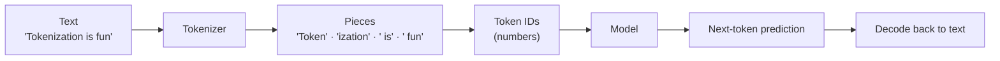

+++
id = "ai.llm.tokens"
title = "Tokens: the unit LLMs read, write and bill"
strand = "intelligence"
module = "llm"
role_tags = ["ai-engineer"]
hard_prereqs = []
soft_prereqs = []
bridges = ["ai.llm.embeddings", "ai.rag.chunking", "ai.serving.kv-cache", "ai.llm.prompt-caching"]
interview_weight = 4
key_points = [
  "LLMs read and write tokens — chunks of text from a fixed vocabulary — not characters or whole words.",
  "Most modern tokenizers are subword schemes such as byte-pair encoding (BPE): common words become one token, rare words split into pieces.",
  "Context windows, pricing and latency are all counted in tokens, so tokens are your unit of capacity and cost.",
  "Token counts depend on the tokenizer and the language: the same meaning can cost more tokens in some languages, and code and numbers often split in surprising ways.",
]
est_minutes = { core = 5, extended = 4, deep = 20 }

[[references]]
title = "Andrej Karpathy — Let's build the GPT Tokenizer"
url = "https://www.youtube.com/watch?v=zduSFxRajkE"
kind = "video"
note = "Builds BPE from scratch; the first 20 minutes explain why tokenization causes so many LLM quirks."

[[references]]
title = "Hugging Face LLM Course — Tokenizers"
url = "https://huggingface.co/learn/llm-course/chapter2/4"
kind = "course"
note = "Word, character and subword tokenization compared, with code."

[[references]]
title = "OpenAI Tokenizer"
url = "https://platform.openai.com/tokenizer"
kind = "tool"
note = "Paste text and see how it splits. Other models use other tokenizers, so counts differ."

[guess]
type = "single_choice"
prompt = "Does an LLM read your prompt letter by letter?"
options = ["Yes, one character at a time", "No, it reads tokens — chunks of text"]
answer = 1
explanation = "Text is first split into tokens (often word pieces) and converted to numbers. The model never sees individual letters unless a token happens to be a single letter."

[[questions]]
id = "what-model-sees"
type = "single_choice"
prompt = "What does the model actually take as input?"
options = [
  "Raw Unicode characters",
  "A sequence of token IDs from its vocabulary",
  "Whole sentences",
  "Images of the text",
]
answer = 1
explanation = "The tokenizer maps text to a list of integer IDs; the model turns each ID into an embedding vector. Output works in reverse: the model predicts token IDs, which are decoded back to text."
difficulty = 1

[[questions]]
id = "bpe"
type = "single_choice"
prompt = "How does byte-pair encoding (BPE) build its vocabulary?"
options = [
  "It takes every word in a dictionary",
  "It starts from bytes or characters and repeatedly merges the most frequent adjacent pair into a new token",
  "It splits text on spaces only",
  "It assigns one token per character",
]
answer = 1
explanation = "BPE counts which adjacent pairs appear most often in training text, merges the top pair into a new symbol, and repeats until the vocabulary reaches its target size. Frequent words end up as single tokens; rare ones stay split."
difficulty = 2

[[questions]]
id = "rule-of-thumb"
type = "single_choice"
prompt = "A common rule of thumb for English text with GPT-style tokenizers is roughly:"
options = [
  "1 token ≈ 1 character",
  "1 token ≈ 4 characters (about ¾ of a word)",
  "1 token ≈ 1 sentence",
  "1 token ≈ 10 words",
]
answer = 1
explanation = "About 4 characters or ¾ of a word per token in English. It's only an estimate: other languages, code and numbers often use more tokens, and every model's tokenizer differs."
difficulty = 1

[[questions]]
id = "cost-estimate"
type = "scenario_tradeoff"
scenario = "A feature handles 20,000 requests a day. Each request sends 1,500 input tokens and gets 300 output tokens back. Hypothetical prices: $1 per million input tokens and $5 per million output tokens."
prompt = "What's the daily model cost?"
options = ["$6", "$36", "$60", "$600"]
answer = 2
explanation = "Input: 20,000 × 1,500 = 30M tokens × $1/M = $30. Output: 20,000 × 300 = 6M tokens × $5/M = $30. Total $60 a day. Notice that output tokens cost as much as five times as many input tokens."
difficulty = 2

[[questions]]
id = "measured-in-tokens"
type = "multi_choice"
prompt = "Which of these are measured or driven by token counts? Select all that apply."
options = [
  "The context window limit",
  "API pricing",
  "Generation time for a long answer",
  "The memory needed to hold the model's weights",
]
answers = [0, 1, 2]
explanation = "Context limits and prices are counted in tokens, and output is generated one token at a time, so longer answers take longer. Weight memory depends on the model's size, not on how many tokens you send (the KV cache, by contrast, does grow with tokens)."
difficulty = 2

[[questions]]
id = "strawberry"
type = "single_choice"
prompt = "Why do LLMs sometimes miscount the letters in a word like 'strawberry'?"
options = [
  "They are trained only on numbers",
  "They see tokens, not individual characters, so letter-level details are hidden inside token IDs",
  "Their context window is too small",
  "Temperature is set too high",
]
answer = 1
explanation = "If 'strawberry' is one or two tokens, the model never directly sees its letters. Spelling, letter counting and some arithmetic suffer for the same reason."
difficulty = 1

[[questions]]
id = "output-slower"
type = "single_choice"
prompt = "Why does a long answer take much longer than a long prompt?"
options = [
  "Output tokens are generated one at a time, each depending on the previous ones, while the prompt is processed in parallel",
  "Output is compressed before sending",
  "The network is slower for responses",
  "Prompts are cached by default",
]
answer = 0
explanation = "The prompt is processed in one parallel pass; the answer is decoded sequentially, one token per step. That's why latency scales with output length, and why output is usually priced higher."
difficulty = 2

[[questions]]
id = "long-chat"
type = "scenario_tradeoff"
scenario = "Your support chatbot sends the whole conversation history with every message. Long chats start hitting the model's context limit and costs are climbing."
prompt = "What's the best fix?"
options = [
  "Raise the temperature",
  "Summarise older turns and/or retrieve only the relevant past messages",
  "Switch to a model with a bigger vocabulary",
  "Send the history twice to be safe",
]
answer = 1
explanation = "Keep what matters and drop the rest: summarise old turns or retrieve the relevant ones. That keeps you inside the window and cuts input tokens per request. Temperature and vocabulary size don't change history length."
difficulty = 2

[[questions]]
id = "different-counts"
type = "single_choice"
prompt = "The same prompt is 1,000 tokens on one model and 1,200 on another. Why?"
options = [
  "One of the APIs is miscounting",
  "The models use different tokenizers with different vocabularies",
  "Token counts depend on the time of day",
  "The second model adds a hidden system prompt to every request",
]
answer = 1
explanation = "Each model family has its own tokenizer and vocabulary, so the same text splits differently. Count tokens with the provider's own tokenizer or token-counting API rather than hard-coding one ratio."
difficulty = 2
+++

## Hook {core}

Paste the same paragraph in English and in Hindi into a tokenizer tool. The Hindi version often comes out noticeably longer in tokens. Same meaning, bigger bill, and less room left in the context window.

As an AI engineer, **tokens are your unit of cost, latency and capacity**. Almost every LLM design question ("how much will this cost?", "why is it slow?", "why doesn't the document fit?") comes back to them.

## What a token is {core}

Before a model sees your text, a **tokenizer** splits it into **tokens** from a fixed vocabulary and turns each into a number (its ID). The model reads IDs and predicts the next ID; the tokenizer turns predicted IDs back into text.

*The split shown is illustrative — every tokenizer splits differently.*

A token is often a whole common word, a piece of a rarer word, punctuation, or a leading space plus a word. A rough English rule of thumb: **1 token ≈ 4 characters ≈ ¾ of a word**.

## How the vocabulary is built {core}

Most modern models use a **subword** scheme such as **byte-pair encoding (BPE)**:

1. Start with raw bytes or characters.
2. Find the most frequent adjacent pair in a large training corpus and merge it into a new token.
3. Repeat until the vocabulary reaches its target size (tens to hundreds of thousands of tokens).

Frequent words become single tokens; rare words, names and many non-English words stay split into several pieces. That's why token counts vary by language and by model.

## Why it matters day to day {core}

- **Context window** = prompt tokens + output tokens. Overflow means something has to be cut, summarised or retrieved more selectively.
- **Pricing** is per million input and output tokens; output usually costs more.
- **Latency** grows with output length, because the model generates one token at a time.

## Connects to {core}

- **Embeddings** — each token ID becomes a vector; that's where meaning starts.
- **RAG chunking** — document chunks are sized in tokens so retrieved context fits the window.
- **KV cache** (serving) — memory per request grows with every token in the context.
- **Prompt caching** — reusing a long, repeated prefix (like a lesson) cuts the cost of those input tokens.

## Gotchas {extended}

- **Letters and digits are hidden inside tokens**, so spelling, letter counting and some arithmetic go wrong.
- **Counts differ by model.** Use the provider's tokenizer or token-counting API; don't hard-code "4 characters per token" into billing logic.
- **Whitespace and formatting cost tokens.** Pretty-printed JSON can cost noticeably more than compact JSON.
- **Bigger vocabularies** mean fewer tokens per text but a larger embedding table and output layer — a model-design trade-off.

## Interview angle {extended}

- **"Estimate the monthly cost of this LLM feature."** — requests × (input tokens × input price + output tokens × output price), then show how caching, shorter prompts or a smaller model change it.
- **"The document doesn't fit in the context window. Options?"** — chunk and retrieve (RAG), summarise, or use a longer-context model, with the cost of each.
- **"Why might users in some languages cost more?"** — tokenizers trained mostly on English split other scripts into more pieces.

## Go deeper {deep}

- Watch the first 20–30 minutes of Karpathy's tokenizer video (in the references).
- **Try it:** paste one paragraph in English and the same paragraph in Hindi into a tokenizer tool. Compare the token counts and look at how each word splits.
- **Calculate:** for a feature you'd like to build, estimate tokens per request and cost per day at 1,000 and at 100,000 requests.
