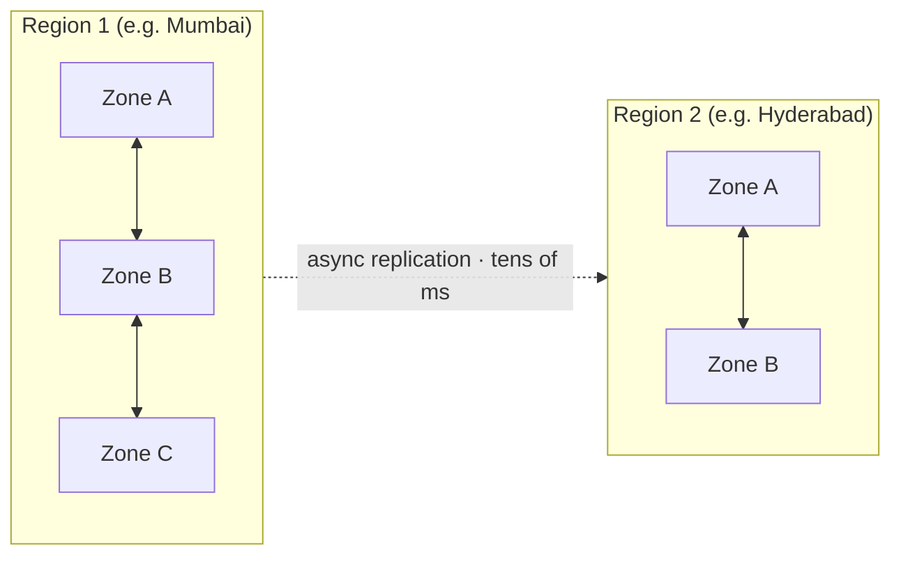

+++
id = "sys.cloud.regions-zones"
title = "Regions, availability zones and failure domains"
strand = "systems"
module = "cloud"
role_tags = ["ai-engineer", "backend"]
hard_prereqs = []
soft_prereqs = []
bridges = ["sys.sd.replication", "sys.sd.load-balancing", "ai.serving.gpu-capacity"]
interview_weight = 4
key_points = [
  "A cloud region is a geographic area containing several availability zones (AZs): isolated data centers with independent power, cooling and networking.",
  "AZs in a region are linked with low latency, so you can replicate synchronously across them; regions are far apart, so cross-region replication is usually asynchronous.",
  "Spread across 2–3 AZs to survive a data-center failure; add a second region to survive a regional outage, at extra cost and complexity.",
  "Talk about availability in terms of failure domains, RPO (data you can lose) and RTO (time to recover).",
]
est_minutes = { core = 5, extended = 4, deep = 10 }

[[references]]
title = "Google Cloud — Regions and zones"
url = "https://cloud.google.com/compute/docs/regions-zones"
kind = "docs"
note = "Clear definitions and a good section on designing for zone failures."

[[references]]
title = "AWS — Regions and Availability Zones"
url = "https://aws.amazon.com/about-aws/global-infrastructure/regions_az/"
kind = "docs"

[[references]]
title = "Microsoft Learn — What are availability zones?"
url = "https://learn.microsoft.com/en-us/azure/reliability/availability-zones-overview"
kind = "docs"
note = "Same idea on Azure; useful for comparing terminology."

[guess]
type = "single_choice"
prompt = "One availability zone in a cloud region loses power. Does the whole region go down?"
options = ["Yes, a region is one data center", "No, the other zones keep running"]
answer = 1
explanation = "Zones are built to fail independently: separate power, cooling and networking. Apps spread across zones keep serving from the healthy ones."

[[questions]]
id = "what-is-az"
type = "single_choice"
prompt = "What is an availability zone?"
options = [
  "A single server rack",
  "One or more isolated data centers in a region, with independent power, cooling and networking",
  "A country-wide group of regions",
  "A CDN edge location",
]
answer = 1
explanation = "An AZ is a group of one or more data centers designed to fail independently of the other AZs in the same region, while staying close enough for low-latency links between them."
difficulty = 1

[[questions]]
id = "survive-dc-failure"
type = "scenario_tradeoff"
scenario = "Your API must stay up if one data center fails. Budget matters and all users are in one country."
prompt = "What's the right baseline?"
options = [
  "One big instance in one zone",
  "Instances in 2–3 zones of one region, behind a load balancer",
  "Active-active across three continents",
]
answer = 1
explanation = "Spreading across zones in one region survives a data-center failure at modest cost and keeps latency low. Multiple continents adds cost and consistency problems you don't need for this goal."
difficulty = 1

[[questions]]
id = "sync-replication"
type = "single_choice"
prompt = "Why can you usually replicate a database synchronously across zones but not across regions?"
options = [
  "Regions use different database engines",
  "Zone-to-zone latency is low (a few ms); region-to-region adds tens to hundreds of ms to every write",
  "Cloud providers forbid cross-region traffic",
  "Zones share the same disks",
]
answer = 1
explanation = "Synchronous replication makes each write wait for the replica's acknowledgement. A few milliseconds between zones is tolerable; a long-distance round trip on every write isn't, so cross-region replication is usually asynchronous."
difficulty = 2

[[questions]]
id = "blast-radius"
type = "multi_choice"
prompt = "Which of these protect you against a larger failure domain? Select all that apply."
options = [
  "Running in multiple zones",
  "Running in multiple regions",
  "Moving to a bigger instance",
  "Adding more replicas in the same zone",
]
answers = [0, 1]
explanation = "Zones protect against a data-center failure, regions against a regional one. A bigger instance or more replicas in the same zone still share that zone's fate."
difficulty = 2

[[questions]]
id = "rpo"
type = "single_choice"
prompt = "What does RPO (recovery point objective) measure?"
options = [
  "How long the service may be down",
  "The maximum amount of data you can afford to lose, measured in time",
  "Requests per second at peak",
  "How many replicas you run",
]
answer = 1
explanation = "RPO = how far back in time you might have to roll back after a disaster. Asynchronous cross-region replication with 30 s of lag means an RPO of roughly 30 s."
difficulty = 1

[[questions]]
id = "rto"
type = "single_choice"
prompt = "What does RTO (recovery time objective) measure?"
options = [
  "The maximum acceptable downtime before service is restored",
  "Round-trip time between regions",
  "Time between backups",
  "How long a TLS handshake takes",
]
answer = 0
explanation = "RTO is how quickly you must be back up. A warm standby region gives a short RTO; restoring from backups gives a long one."
difficulty = 1

[[questions]]
id = "data-residency-dr"
type = "scenario_tradeoff"
scenario = "Regulations require customer payment data to stay in India. Users are mostly in India. The business wants disaster recovery for a regional outage."
prompt = "Which design fits?"
options = [
  "Primary in one Indian region, standby in a second Indian region",
  "Primary in India, standby in Singapore",
  "A single zone in India with nightly backups to another country",
]
answer = 0
explanation = "Two in-country regions (for example Mumbai and Hyderabad on AWS) satisfy residency and survive a regional outage. Anything that replicates data abroad breaks the rule; a single zone doesn't survive a regional outage at all."
difficulty = 2

[[questions]]
id = "hidden-cost"
type = "single_choice"
prompt = "What's a commonly overlooked cost of spreading a chatty service across zones?"
options = [
  "Zones charge extra for load balancers",
  "Data transferred between zones is usually billed",
  "Each zone needs its own domain name",
  "Instances cost twice as much in a second zone",
]
answer = 1
explanation = "Major clouds bill traffic that crosses zone boundaries. Chatty services and cross-zone replication can add a surprising line to the bill, so keep hot paths zone-local where you can."
difficulty = 2

[[questions]]
id = "failover-order"
type = "order_steps"
prompt = "Active–passive regional failover: put the steps in order."
steps = [
  "Health checks detect that the primary region is down",
  "Promote the standby region's database replica to primary",
  "Switch DNS or the global load balancer to send traffic to the standby region",
  "Later, rebuild the old primary region as the new standby",
]
explanation = "Detect, promote the data store, move traffic, then restore redundancy. Moving traffic before the database is promoted would send writes to a read-only replica."
difficulty = 3
+++

## Hook {core}

A data center loses power at 3 a.m. Does your app go down? It depends almost entirely on one early decision: did you run in one zone or several?

"Design this for high availability" is one of the most common system design follow-ups, and the answer always starts with **failure domains**: the things that can fail together.

## Regions and zones {core}

Cloud providers group their infrastructure in two levels:

- A **region** is a geographic area (for example Mumbai, Frankfurt, Virginia).
- An **availability zone (AZ)** is one or more data centers inside a region, with **independent power, cooling and networking**. Zones are close enough for low-latency links (a few milliseconds) but far enough apart not to fail together.

Inside a region, zones are close enough to keep replicas **in sync**. Between regions the distance makes every round trip expensive, so replication is usually **asynchronous**: the standby lags a little behind.

## Failure domains {core}

Think in rings of "what can fail together": process → machine → rack → **zone** → **region** → whole provider. Each design choice decides which ring you survive:

- **One zone** — survives a single machine failure (if you have more than one machine).
- **Multiple zones** — survives a data-center failure. This is the sensible default for production.
- **Multiple regions** — survives a regional outage or serves users on other continents faster, but adds cost, latency and consistency problems.

## Connects to {core}

- **Replication** (system design) — synchronous vs asynchronous is exactly the zone-vs-region trade-off.
- **Load balancing** — a regional load balancer spreads traffic across zones and stops sending to an unhealthy one.
- **AI serving** — GPU capacity differs by region and zone, so model-serving fleets often span zones (or regions) just to find enough accelerators.

## Trade-offs {extended}

- **Cost:** traffic between zones is usually billed, and a second region roughly doubles standby infrastructure.
- **Consistency:** async cross-region replication means a failover can lose the last few seconds of writes (your **RPO**).
- **Complexity:** active–active across regions needs conflict handling; active–passive is simpler but the standby sits mostly idle.
- **Residency:** regulators can require data to stay in-country, which decides your region choices for you.

## Interview angle {extended}

- **"Make this highly available."** — Start with multi-zone: stateless app servers in 2–3 zones behind a load balancer, database with a synchronous standby in another zone.
- **"What if the whole region goes down?"** — Second region, asynchronous replication, DNS or global load-balancer failover; state your **RPO** and **RTO**.
- **Follow-ups:** why not synchronous across regions, cost of cross-zone traffic, how you test failover (game days).

## Go deeper {deep}

- Read Google Cloud's "Regions and zones" page in the references, including its guidance on designing for zone failures.
- **Try it:** list the zones of a region near you, e.g. `aws ec2 describe-availability-zones --region ap-south-1` or `gcloud compute zones list --filter="region:asia-south1"`.
- **Think it through:** for a payments API and for an internal analytics dashboard, write down a sensible RPO and RTO for each, and which architecture each implies.
