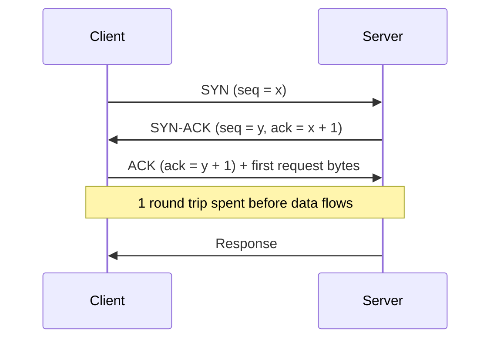

+++
id = "sys.net.tcp-handshake"
title = "The TCP three-way handshake"
strand = "systems"
module = "networking"
role_tags = ["ai-engineer", "backend"]
hard_prereqs = ["sys.net.tcp-ip-model"]
soft_prereqs = []
bridges = ["sys.sd.connection-pooling", "sys.net.tls", "ai.serving.token-streaming-sse"]
interview_weight = 4
key_points = [
  "SYN → SYN-ACK → ACK opens a connection and exchanges initial sequence numbers in both directions.",
  "The handshake costs one round trip before any request data can flow; TLS then adds one more (TLS 1.3) or two (TLS 1.2).",
  "Sequence numbers and ACKs give TCP ordered, reliable delivery; FIN closes a connection gracefully and RST aborts it.",
  "Because handshakes cost latency, real systems reuse connections (keep-alive, pooling), and HTTP/3 over QUIC folds the transport and TLS handshakes together.",
]
est_minutes = { core = 5, extended = 4, deep = 10 }

[[references]]
title = "High Performance Browser Networking — Building Blocks of TCP"
url = "https://hpbn.co/building-blocks-of-tcp/"
kind = "book"
note = "Free online chapter by Ilya Grigorik; the clearest explanation of handshake latency."

[[references]]
title = "RFC 9293 — Transmission Control Protocol"
url = "https://www.rfc-editor.org/rfc/rfc9293"
kind = "docs"
note = "The current TCP specification; section 3.5 covers connection establishment."

[[references]]
title = "Cloudflare Learning — What is TCP/IP?"
url = "https://www.cloudflare.com/learning/ddos/glossary/tcp-ip/"
kind = "article"

[guess]
type = "single_choice"
prompt = "Before the first byte of your API request leaves your machine, how many network round trips does opening a brand-new TCP connection cost?"
options = ["0", "1", "2"]
answer = 1
explanation = "One. The client sends SYN, waits for SYN-ACK, and only then can it send its ACK along with the first data. TLS on top adds more round trips."

[[questions]]
id = "handshake-order"
type = "order_steps"
prompt = "Put the start of a TCP connection in order."
steps = [
  "Client sends SYN with its initial sequence number",
  "Server replies SYN-ACK with its own sequence number and an ACK of the client's",
  "Client sends ACK of the server's sequence number",
  "Client sends the first request bytes",
]
explanation = "SYN, SYN-ACK, ACK. The client is allowed to put request data in the same packet as its final ACK, so data starts flowing after exactly one round trip."
difficulty = 1

[[questions]]
id = "what-is-exchanged"
type = "single_choice"
prompt = "After the handshake, what has each side learned that it needs for reliable delivery?"
options = [
  "The other side's MAC address",
  "The other side's initial sequence number",
  "The other side's TLS certificate",
  "The other side's process ID",
]
answer = 1
explanation = "Each side picks an initial sequence number (ISN) and confirms the other's. Every later byte is numbered from there, which is how TCP detects loss, reorders segments and drops duplicates."
difficulty = 2

[[questions]]
id = "rtts-before-request"
type = "single_choice"
prompt = "A client opens a new HTTPS connection using TLS 1.3. How many round trips pass before it can send the HTTP request?"
options = ["1", "2", "3", "4"]
answer = 1
explanation = "Two: one for the TCP handshake and one for the TLS 1.3 handshake. The response arrives after a third. With TLS 1.2 the TLS part alone takes two round trips."
difficulty = 2

[[questions]]
id = "pooling"
type = "scenario_tradeoff"
scenario = "Service A calls service B 50 times a second and opens a new HTTPS connection for every call. B is in another region, ~80 ms away. A's p99 latency is far above B's own processing time."
prompt = "What's the most effective first fix?"
options = [
  "Give service B more CPU",
  "Reuse connections with keep-alive and a connection pool",
  "Switch from TCP to UDP",
  "Add more instances of service A",
]
answer = 1
explanation = "Each new connection pays the TCP and TLS handshakes — two round trips, ~160 ms here — before any work starts. Reusing pooled connections pays that once. More CPU or instances don't remove network round trips."
difficulty = 2

[[questions]]
id = "syn-flood"
type = "single_choice"
prompt = "What does a SYN flood attack exhaust, and what's a classic defence?"
options = [
  "Server bandwidth; defend with compression",
  "The server's queue of half-open connections; defend with SYN cookies",
  "The client's sequence numbers; defend with longer timeouts",
  "TLS certificates; defend with certificate pinning",
]
answer = 1
explanation = "The attacker sends SYNs and never completes the handshake, filling the server's table of half-open connections so real clients can't connect. SYN cookies encode the connection state into the server's sequence number, so the server doesn't store anything until the final ACK arrives."
difficulty = 3

[[questions]]
id = "why-three"
type = "single_choice"
prompt = "Why does TCP use three messages instead of two?"
options = [
  "To exchange encryption keys",
  "So both sides confirm the other's sequence number, and stale duplicate SYNs can't open bogus connections",
  "Because IP can't carry more than three packets at once",
  "To measure the bandwidth of the link",
]
answer = 1
explanation = "With two messages, the server could never be sure the client received its sequence number, and a delayed SYN from an old connection could open a new one by accident. The third message closes both gaps."
difficulty = 2

[[questions]]
id = "reduce-handshake-latency"
type = "multi_choice"
prompt = "Which of these reduce the latency cost of handshakes? Select all that apply."
options = [
  "Connection pooling / HTTP keep-alive",
  "Using TLS 1.3 instead of TLS 1.2",
  "HTTP/3 over QUIC",
  "Giving the server a faster CPU",
]
answers = [0, 1, 2]
explanation = "Pooling avoids repeat handshakes; TLS 1.3 needs one round trip instead of two; QUIC combines the transport and TLS handshakes (and can resume with zero round trips). CPU speed doesn't shorten network round trips."
difficulty = 2

[[questions]]
id = "time-wait"
type = "single_choice"
prompt = "Which side of a TCP connection ends up in the TIME_WAIT state?"
options = [
  "The side that closes first (sends the first FIN)",
  "Always the server",
  "Always the client",
  "The side that receives the RST",
]
answer = 0
explanation = "The active closer waits in TIME_WAIT (twice the maximum segment lifetime) so stray packets from the old connection can't confuse a new one. Clients that open and close many short connections can run out of local ports because of this — another reason to pool."
difficulty = 3

[[questions]]
id = "abort"
type = "single_choice"
prompt = "Which TCP flag tells the other side to abandon the connection immediately?"
options = ["FIN", "ACK", "RST", "PSH"]
answer = 2
explanation = "RST (reset) aborts the connection at once, for example when a packet arrives for a port nobody is listening on. FIN is the graceful close."
difficulty = 1
+++

## Hook {core}

Your server is 100 ms away. Before a single byte of your JSON leaves your machine, TCP spends a full round trip just saying hello, and TLS spends at least one more. At 100 ms each, that's 200 ms gone before the server even sees your request.

That's why "reuse connections" is one of the cheapest latency wins in any system, and why interviewers love asking you to walk through the handshake.

## Three messages {core}

TCP is connection-oriented: both sides agree to talk and agree on **sequence numbers** before sending data.

1. **SYN** — "I'd like to talk; my numbering starts at x."
2. **SYN-ACK** — "Got x. My numbering starts at y."
3. **ACK** — "Got y." The client may send data in the same packet.

From then on every byte has a sequence number, so the receiver can put segments back in order, spot gaps and ask for resends. That's the "reliable" in TCP.

## Why three, not two {core}

Two messages would leave the server unsure whether the client ever got *its* sequence number. Worse, a delayed SYN from an old, dead connection could arrive later and open a bogus new one. The third message lets both sides confirm each other, and lets the client ignore SYN-ACKs it never asked for.

Closing is separate: each side sends **FIN** when it's done sending (a graceful close), while **RST** aborts immediately.

## Connects to {core}

- **The TCP/IP model** — the handshake lives in the transport layer's envelope.
- **Connection pooling** (system design) — amortises the handshake across many requests.
- **Streaming LLM tokens** — one long-lived connection carries the whole streamed response, so you pay the handshake once per stream.

## Trade-offs and failure modes {extended}

- **Latency:** new HTTPS connection = TCP (1 round trip) + TLS 1.3 (1 round trip) + request (1 round trip). Pooling and keep-alive pay the setup once. HTTP/3 over QUIC merges transport and TLS setup into one round trip, and can resume with zero.
- **SYN floods:** attackers send SYNs and never finish, filling the server's half-open queue. SYN cookies let the server keep no state until the final ACK.
- **TIME_WAIT:** the side that closes first waits a while before the port can be reused. Clients that open thousands of short connections can run out of local ports.

## Interview angle {extended}

- **"Walk me through the TCP handshake."** — SYN, SYN-ACK, ACK; mention sequence numbers and the one round-trip cost.
- **"Why not two-way?"** — confirming both sequence numbers and rejecting stale duplicate SYNs.
- **"How many round trips until the first response over HTTPS?"** — three with TLS 1.3, four with TLS 1.2.
- **Follow-ups:** SYN flood and SYN cookies; TIME_WAIT and port exhaustion; why QUIC runs over UDP.

## Go deeper {deep}

- Read the HPBN chapter in the references — especially the part on slow start, which also explains why new connections start slow.
- **See it:** run Wireshark (or `sudo tcpdump -n 'tcp[tcpflags] & tcp-syn != 0'`) while you `curl` a site, and spot the SYN and SYN-ACK.
- **Measure it:** `curl -w "connect: %{time_connect}s  tls: %{time_appconnect}s  first byte: %{time_starttransfer}s\n" -o /dev/null -s https://example.com`.
