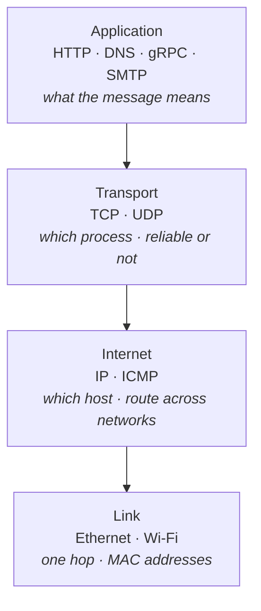

+++
id = "sys.net.tcp-ip-model"
title = "The TCP/IP model and encapsulation"
strand = "systems"
module = "networking"
role_tags = ["ai-engineer", "backend"]
hard_prereqs = []
soft_prereqs = []
bridges = ["sys.sd.load-balancing", "sys.net.dns", "ai.serving.token-streaming-sse"]
interview_weight = 4
key_points = [
  "The TCP/IP model has four layers — link, internet, transport, application; the 7-layer OSI model splits the same work more finely.",
  "Each layer wraps the data from the layer above in its own header (encapsulation): HTTP message → TCP segment → IP packet → Ethernet frame.",
  "IP moves packets host to host on a best-effort basis; TCP or UDP adds port numbers so data reaches the right process.",
  "Layer numbers matter in design talk: an L4 load balancer sees IPs and ports, an L7 one understands HTTP paths and headers.",
]
est_minutes = { core = 5, extended = 4, deep = 10 }

[[references]]
title = "Cloudflare Learning — What is the OSI model?"
url = "https://www.cloudflare.com/learning/ddos/glossary/open-systems-interconnection-model-osi/"
kind = "article"
note = "Plain-language walk through all seven layers."

[[references]]
title = "RFC 1122 — Requirements for Internet Hosts: Communication Layers"
url = "https://www.rfc-editor.org/rfc/rfc1122"
kind = "docs"
note = "Section 1.1.3 defines the four-layer Internet architecture."

[guess]
type = "single_choice"
prompt = "How many layers does the TCP/IP model (as defined for Internet hosts) have?"
options = ["4", "5", "7"]
answer = 0
explanation = "Four: link, internet, transport and application (RFC 1122). Some textbooks draw five by splitting the link layer into data link and physical; OSI has seven."

[[questions]]
id = "host-to-host"
type = "single_choice"
prompt = "Which layer is responsible for getting a packet from one host to another across many networks?"
options = ["Link", "Internet (IP)", "Transport (TCP/UDP)", "Application"]
answer = 1
explanation = "The internet layer (IP) handles addressing and routing between hosts. The link layer only covers one hop; transport adds process-to-process delivery on top."
difficulty = 1

[[questions]]
id = "which-process"
type = "single_choice"
prompt = "A packet reaches the right machine. What tells the OS which process should get it?"
options = ["The MAC address", "The IP address", "The port number", "The HTTP Host header"]
answer = 2
explanation = "Transport-layer port numbers identify the process (strictly, the socket) on a host. The IP address only gets the packet to the machine."
difficulty = 1

[[questions]]
id = "encapsulation-order"
type = "order_steps"
prompt = "A browser sends an HTTP request. Put the wrapping steps in order."
steps = [
  "The application creates the HTTP request",
  "TCP adds a header with source and destination ports",
  "IP adds a header with source and destination IP addresses",
  "Ethernet / Wi-Fi adds a frame header with MAC addresses",
  "The frame is sent as bits on the physical medium",
]
explanation = "Each layer wraps the one above: application data → TCP segment → IP packet → link-layer frame → signal on the wire. The receiver unwraps in reverse."
difficulty = 1

[[questions]]
id = "l7-routing"
type = "scenario_tradeoff"
scenario = "Requests to /api/* must go to the API service and /images/* to a separate image service, all behind one public IP and port 443."
prompt = "What kind of load balancer do you need?"
options = [
  "An L4 (transport) load balancer",
  "An L7 (application) load balancer",
  "Two separate DNS records for the same hostname",
]
answer = 1
explanation = "Routing by URL path needs to read the HTTP request, which only an L7 load balancer does (after terminating TLS). An L4 balancer only sees IPs and ports, so it can't tell /api from /images."
difficulty = 2

[[questions]]
id = "app-layer-protocols"
type = "multi_choice"
prompt = "Which of these are application-layer protocols?"
options = ["HTTP", "DNS", "IP", "SMTP", "Ethernet"]
answers = [0, 1, 3]
explanation = "HTTP, DNS and SMTP are application protocols. IP is the internet layer; Ethernet is the link layer."
difficulty = 1

[[questions]]
id = "ping"
type = "single_choice"
prompt = "`ping` checks whether a host is reachable. What does it use?"
options = ["TCP", "UDP", "ICMP", "HTTP"]
answer = 2
explanation = "ping sends ICMP echo requests. ICMP is a control protocol carried directly in IP packets, so a host can answer ping with no TCP or UDP service running."
difficulty = 2

[[questions]]
id = "per-hop-change"
type = "single_choice"
prompt = "A packet crosses three routers (no NAT). What gets replaced at every hop?"
options = [
  "The source and destination IP addresses",
  "The link-layer frame (MAC addresses), and the IP TTL is decremented",
  "The TCP port numbers",
  "The HTTP headers",
]
answer = 1
explanation = "Each router strips the incoming link-layer frame and builds a new one for the next hop, and decrements the IP time-to-live. The IP addresses, ports and HTTP data stay end to end (unless NAT rewrites them)."
difficulty = 3

[[questions]]
id = "osi-mapping"
type = "single_choice"
prompt = "OSI layers 5, 6 and 7 (session, presentation, application) map to which TCP/IP layer?"
options = ["Transport", "Internet", "Application", "Link"]
answer = 2
explanation = "The TCP/IP model folds OSI's top three layers into one application layer. That's why TLS, which OSI would call presentation/session, is usually just treated as sitting between the application and TCP."
difficulty = 2
+++

## Hook {core}

When your app calls an API, the JSON doesn't just "go over the internet". It's wrapped in four envelopes, each read by a different kind of machine on the way: your OS, every router, the load balancer, and finally the server.

Knowing which envelope each machine reads is what lets you answer "what happens when I type a URL?", debug a timeout, or pick between an L4 and an L7 load balancer.

## Four layers {core}

The Internet's own model (RFC 1122) has **four layers**. Each one solves one problem and relies on the layer below.

- **Link** moves a frame across one hop (your laptop → Wi-Fi router).
- **Internet (IP)** moves a packet between any two hosts, hop by hop, with no delivery guarantee.
- **Transport** adds **ports** so data reaches the right process. TCP adds reliability and ordering; UDP doesn't.
- **Application** is the conversation itself: HTTP requests, DNS lookups, and so on.

## Encapsulation step by step {core}

Sending an HTTP request:

1. Your app writes the **HTTP request**.
2. TCP wraps it in a **segment** with source and destination **ports**.
3. IP wraps that in a **packet** with source and destination **IP addresses**.
4. The link layer wraps that in a **frame** with **MAC addresses** for the next hop.

Each router on the way unwraps only the frame, looks at the IP header to choose the next hop, and builds a fresh frame. The server unwraps all four layers in reverse.

## Connects to {core}

- **TCP handshake** — the next topic: how TCP sets up the reliable connection inside these envelopes.
- **Load balancing** — "L4 vs L7" is literally which envelope the balancer opens.
- **Streaming LLM tokens** — server-sent events are just a long-lived HTTP response over one TCP connection.

## OSI vs TCP/IP {extended}

Interviews mix the two, so know the mapping:

| OSI | TCP/IP | Examples |
|---|---|---|
| 7 Application · 6 Presentation · 5 Session | Application | HTTP, DNS, TLS (roughly) |
| 4 Transport | Transport | TCP, UDP |
| 3 Network | Internet | IP, ICMP |
| 2 Data link · 1 Physical | Link | Ethernet, Wi-Fi |

"Layer 4" and "layer 7" in system design always use the **OSI numbers**.

## Interview angle {extended}

- **"What happens when you type a URL?"** — DNS lookup (application, over UDP or TCP), TCP handshake, TLS handshake, HTTP request; mention the layers as you go.
- **"L4 vs L7 load balancer?"** — L4 routes by IP/port and is faster and protocol-agnostic; L7 terminates TLS, reads HTTP and can route by path, header or cookie.
- **Trick question:** "Is ping TCP or UDP?" — neither, it's ICMP.

## Go deeper {deep}

- Read RFC 1122 §1.1.3 for the original four-layer definition.
- **Try it:** run `curl -v https://example.com` and label each line of output with its layer (DNS, TCP connect, TLS, HTTP).
- **Try it:** run `traceroute` (or `tracert` on Windows) to a distant site and count the router hops your packets take.
