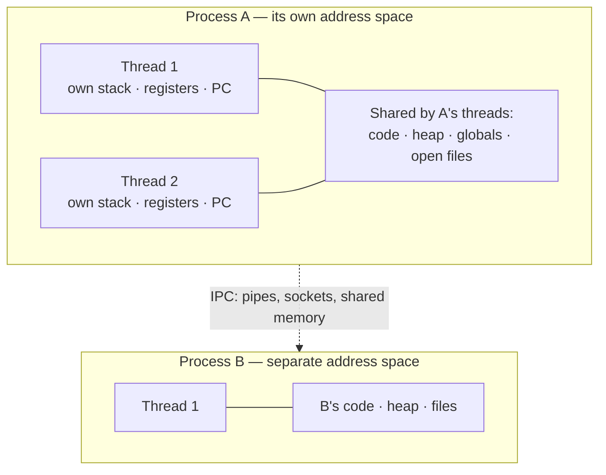

+++
id = "sys.os.processes-threads"
title = "Processes vs threads"
strand = "systems"
module = "os"
role_tags = ["ai-engineer", "backend"]
hard_prereqs = []
soft_prereqs = []
bridges = ["sys.os.concurrency-locks", "sys.cloud.containers", "ai.serving.model-workers"]
interview_weight = 5
key_points = [
  "A process is a running program with its own virtual address space, open files and at least one thread.",
  "Threads of one process share its memory and files, but each thread has its own stack, registers and program counter.",
  "Threads are cheaper to create and switch between; processes give stronger isolation, so one crash or memory bug stays contained.",
  "Shared memory makes threads fast to communicate but needs synchronisation, or updates race and get lost.",
]
est_minutes = { core = 5, extended = 4, deep = 10 }

[[references]]
title = "OSTEP — The Abstraction: The Process"
url = "https://pages.cs.wisc.edu/~remzi/OSTEP/cpu-intro.pdf"
kind = "book"
note = "Free OS textbook chapter; clear and short."

[[references]]
title = "OSTEP — Concurrency: An Introduction"
url = "https://pages.cs.wisc.edu/~remzi/OSTEP/threads-intro.pdf"
kind = "book"
note = "Threads, shared data and why races happen."

[[references]]
title = "clone(2) — Linux manual page"
url = "https://man7.org/linux/man-pages/man2/clone.2.html"
kind = "docs"
note = "Deep layer: on Linux, threads and processes are both created with clone, differing in what they share."

[guess]
type = "single_choice"
prompt = "Two threads run inside the same process. Does each one get its own copy of the heap?"
options = ["Yes, each thread has a private heap", "No, they share the process's heap"]
answer = 1
explanation = "Threads share the process's address space, including the heap. What each thread owns privately is its stack, registers and program counter."

[[questions]]
id = "shared-state"
type = "single_choice"
prompt = "Which of these is shared by all threads in a process?"
options = ["Stack", "Program counter", "Heap", "CPU registers"]
answer = 2
explanation = "The heap lives in the process's address space, which every thread shares. Stack, registers and program counter are per-thread, which is what lets each thread run its own sequence of calls."
difficulty = 1

[[questions]]
id = "per-thread-state"
type = "multi_choice"
prompt = "Which of these does each thread have its own copy of? Select all that apply."
options = ["Stack", "Registers", "Program counter", "Open file descriptors"]
answers = [0, 1, 2]
explanation = "Stack, registers and program counter are the execution state the OS saves and restores per thread. File descriptors belong to the process, so all its threads share them."
difficulty = 1

[[questions]]
id = "browser-tabs"
type = "scenario_tradeoff"
scenario = "You're designing a browser. A badly behaved web page in one tab must not crash the whole browser or read memory belonging to another tab."
prompt = "How should each tab run?"
options = [
  "As a thread inside one shared browser process",
  "As a separate process per tab (or per site)",
  "As a coroutine on a single thread",
]
answer = 1
explanation = "Separate processes give each tab its own address space, so a crash or memory-corruption bug stays inside that process. Chrome uses this multi-process design. Threads or coroutines would share memory, so one bad tab could take down or read the others."
difficulty = 2

[[questions]]
id = "switch-cost"
type = "single_choice"
prompt = "Why is switching between two threads of the same process usually cheaper than switching between two processes?"
options = [
  "Threads don't have registers to save",
  "The CPU doesn't need to switch to a different address space",
  "Threads never enter the kernel",
  "Processes must be reloaded from disk",
]
answer = 1
explanation = "Both kinds of switch save and restore registers. Switching processes also changes the active address space (page tables), which costs time and makes the CPU's address-translation caches less effective. Threads of one process skip that step."
difficulty = 2

[[questions]]
id = "lost-updates"
type = "spot_the_bug"
prompt = "Four threads should add up to 400,000. What's the bug?"
language = "python"
code = '''
import threading

counter = 0

def work():
    global counter
    for _ in range(100_000):
        counter += 1

threads = [threading.Thread(target=work) for _ in range(4)]
for t in threads: t.start()
for t in threads: t.join()
print(counter)  # expected 400000
'''
options = [
  "The threads are never started",
  "`counter += 1` updates shared state without a lock",
  "`join()` must be called before `start()`",
  "`global` can't be used inside a thread function",
]
answer = 1
explanation = "`counter += 1` is a read-modify-write on shared memory. Two threads can read the same value and both write back value+1, losing an update. It is not guaranteed to be atomic, so protect it with a `threading.Lock` (or avoid shared state)."
difficulty = 2

[[questions]]
id = "context-switch-order"
type = "order_steps"
prompt = "Put the steps of a timer-driven context switch in order."
steps = [
  "A timer interrupt fires and the CPU enters the kernel",
  "The kernel saves the current thread's registers",
  "The scheduler picks the next thread to run",
  "If it belongs to another process, the kernel switches the address space",
  "The kernel restores the next thread's registers and returns to user mode",
]
explanation = "Interrupt → save → choose → (switch address space if needed) → restore and resume. The address-space step is the extra cost that makes process switches pricier than thread switches."
difficulty = 2

[[questions]]
id = "fork"
type = "single_choice"
prompt = "What does fork() do on Unix?"
options = [
  "Starts a new thread in the same process",
  "Creates a child process whose memory starts as a copy-on-write copy of the parent's",
  "Replaces the current program with a new one",
  "Duplicates only the parent's open files",
]
answer = 1
explanation = "fork() creates a new process. Its memory is logically a copy of the parent's, but pages are shared until one side writes (copy-on-write), which keeps fork cheap. Replacing the program is exec()."
difficulty = 2

[[questions]]
id = "python-cpu-bound"
type = "scenario_tradeoff"
scenario = "A Python service resizes images: pure CPU work, no waiting on the network. The machine has 8 cores. On the standard CPython build, threads don't speed it up."
prompt = "What's the usual fix?"
options = [
  "Use more threads",
  "Use multiple processes (e.g., multiprocessing or a process pool)",
  "Use asyncio",
  "Increase the thread stack size",
]
answer = 1
explanation = "Standard CPython has a Global Interpreter Lock, so only one thread runs Python bytecode at a time. Separate processes each get their own interpreter and can use all cores. asyncio helps with waiting on I/O, not CPU work. (Free-threaded CPython builds, introduced experimentally in 3.13, remove this limit.)"
difficulty = 3

[[questions]]
id = "thread-crash"
type = "single_choice"
prompt = "One thread in a server process dereferences a null pointer and crashes. What usually happens?"
options = [
  "Only that thread stops; the others carry on",
  "The whole process is terminated",
  "The OS restarts just that thread",
  "Nothing — the memory error is ignored",
]
answer = 1
explanation = "A fatal signal like a segmentation fault terminates the whole process by default, taking every thread with it. That's the price of sharing one address space, and why isolation-critical work runs in separate processes."
difficulty = 2
+++

## Hook {core}

Open 30 tabs in Chrome and kill one tab's page with a buggy script: the other 29 keep working. Now picture a Python web server where one thread corrupts a shared dictionary: every request it serves goes wrong.

The difference is **processes vs threads**: what is isolated and what is shared. Interviewers ask it constantly because every concurrency, scaling and model-serving decision you make sits on top of it.

## The core idea {core}

A **process** is a running program. The OS gives it its own **virtual address space** (code, globals, heap), its open files and sockets, and at least one **thread**.

A **thread** is one flow of execution inside a process. Threads share everything the process owns, but each thread keeps its **own stack, CPU registers and program counter**, so each can be in a different function at the same moment.

Two threads talk by simply reading and writing the same memory. Two processes can't see each other's memory, so they talk through **inter-process communication**: pipes, sockets, or a shared-memory region set up on purpose.

## Context switching {core}

A core runs one thread at a time. To share it, the OS performs a **context switch**: save the running thread's registers, pick another thread, restore its registers, resume.

Switching between threads of the **same** process stops there. Switching to a thread of a **different** process also swaps the address space, which costs more and leaves the CPU's address-translation caches less useful. That's why threads are the cheaper unit to create and switch, and processes the stronger unit of isolation.

## Connects to {core}

- **Locks and race conditions** — the price of shared memory (coming in the concurrency topics).
- **Containers** — a container is a process with extra isolation (its own view of files, network and limits).
- **Model serving** — inference servers run several worker processes, each loading the model, to use every core or GPU without one crash taking down the rest.

## Trade-offs and failure modes {extended}

| | Threads | Processes |
|---|---|---|
| Create / switch | Cheap | More expensive |
| Communication | Shared memory — fast | IPC — explicit, slower |
| Isolation | One crash kills all threads | A crash stays in its process |
| Main risk | Race conditions, deadlocks | Memory per process, IPC overhead |

**Python note:** standard CPython has a Global Interpreter Lock (GIL), so only one thread runs Python bytecode at a time. Threads still help with I/O-bound work (waiting on the network or disk); CPU-bound work needs multiple processes. Free-threaded builds (experimental since 3.13) remove the GIL.

## Interview angle {extended}

Common prompts:
- "What's the difference between a process and a thread?" — answer with *address space* and *what's shared vs per-thread*, then give one trade-off.
- "When would you choose processes over threads?" — isolation, crash containment, security boundaries, or getting past a GIL.
- Follow-ups: what a context switch saves, why thread switches are cheaper, how `fork()` stays cheap with copy-on-write, and what happens when one thread crashes (the whole process dies).

## Go deeper {deep}

- Read the two OSTEP chapters in the references; both are short and free.
- **Try it:** write a CPU-bound function (sum of squares to 10⁷). Time it with 4 threads, then with a 4-process pool. On standard CPython only the processes should speed up.
- **See it:** on Linux, `ps -eLf` lists every thread with its process ID; `top -H` shows threads live.
